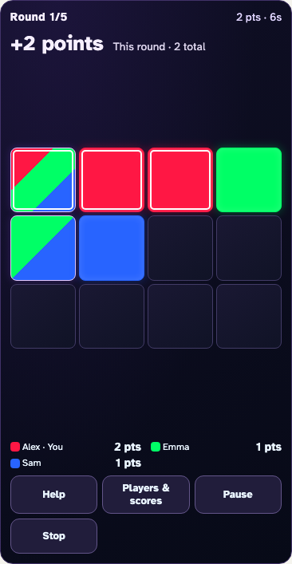
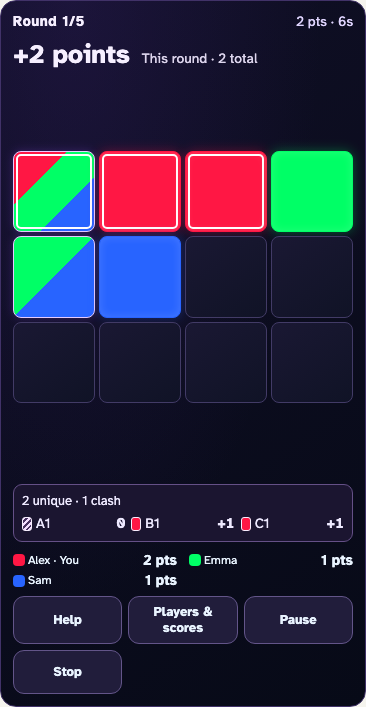
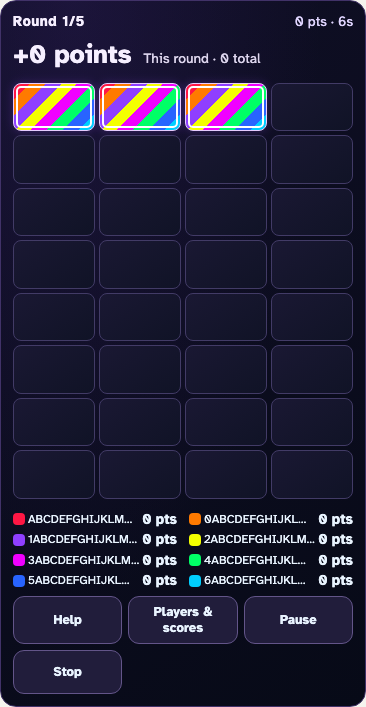
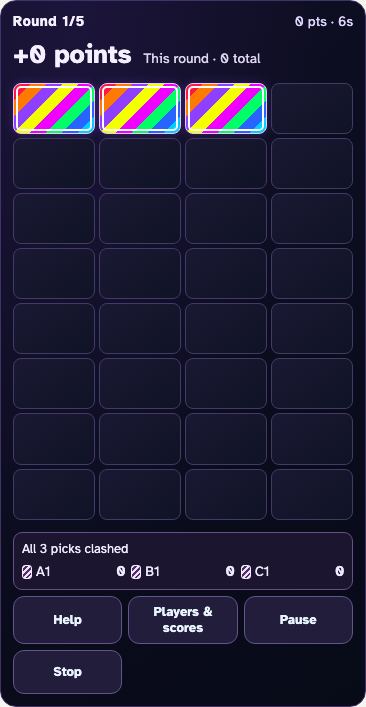

# Glow Clash reveal comparisons

The before images are the accepted Darwin baselines at `c52b09f`. The after
images use the same 390×844 viewport, bundled font, player colors and deliberate
round outcomes. Full-image comparisons preserve the board, controls and totals.
The small summary shows how each of your three picks contributes to the gain;
dense phone standings move into Players & scores to preserve board space.

| Mixed round: before                              | Mixed round: after                                                               |
| ------------------------------------------------ | -------------------------------------------------------------------------------- |
|  |  |

| Eight-player all-clash round: before                    | Eight-player all-clash round: after                                                     |
| ------------------------------------------------------- | --------------------------------------------------------------------------------------- |
|  |  |

[Landscape iPad reward](../../tests/glow.spec.ts-snapshots/glow-mixed-ipad-darwin.png)
· [Full compact picker](../../tests/glow.spec.ts-snapshots/glow-eight-picker-darwin.png)
· [Three unique claims](../../tests/glow.spec.ts-snapshots/glow-unique-darwin.png)
